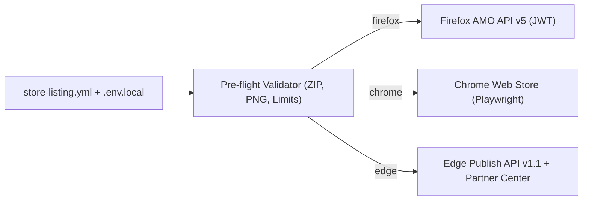

<div align="center">
  
  <p>
    <strong>A multi-store CLI that validates and publishes browser extensions to Chrome Web Store, Microsoft Edge Add-ons, and Firefox AMO from one YAML file.</strong><br/>
    extship checks manifest permissions, ZIP archives, PNG dimensions, and localized descriptions before syncing listings and packages across all three registries. Built for extension maintainers shipping Manifest V2 and V3 builds with Playwright browser automation and official store APIs.
  </p>
  <p>
    <a href="#status"></a>
    <a href="#quickstart"></a>
    <a href="#how-it-works"></a>
    <a href="package.json"></a>
  </p>
  <p>
    <a href="#quickstart">Quickstart</a> •
    <a href="#features">Features</a> •
    <a href="#how-it-works">How it works</a> •
    <a href="#usage">Usage</a> •
    <a href="#configuration">Configuration</a>
  </p>
</div>

## Quickstart

Requires **Node.js 22+** and **pnpm**.

```bash
git clone https://github.com/elcoosp/extship.git
cd extship
pnpm install
pnpm build
```

Run validation against any repository containing a `store-listing.yml` file:

```bash
node dist/cli.js --validate-only
```

```text
🔍 Validation multi-store (firefox, chrome, edge)...
✅ Métadonnées et packages 100 % conformes pour : firefox, chrome, edge !
```

## Features

- **Pre-flight store validation**: Verifies ZIP archive existence, PNG dimensions (`128x128`, `300x300`, `440x280`, `1280x800`), title/summary character caps (`75`/`132` on Chrome and Edge, `50`/`250` on Firefox), and keyword stuffing rules before touching any remote dashboard.
- **Single-source multilingual YAML**: Defines `title`, `summary`, `detailedDescription`, `releaseNotes`, and permission justifications once in `store-listing.yml` across all supported locales.
- **Persistent browser sessions**: Stores authenticated Chromium profiles for Chrome Web Store Developer Dashboard and Edge Partner Center in `~/.cache/extship` so subsequent runs require zero manual sign-in.
- **Official API + Playwright hybrid sync**: Uploads Firefox `.zip` and source archives via the AMO v5 JWT API, pushes Edge packages through the Edge Add-ons v1.1 REST API, and updates localized listing metadata in Chrome and Edge dashboards.
- **Safe dry-run and target filtering**: Supports `--validate-only`, `--dry-run`, `--config <path>`, and `--target chrome,edge,firefox` for incremental releases.

## How it works

`extship` reads `store-listing.yml` (or `store-listing.yaml`) from the current repository, loads `.env.local` credentials when present, validates every store constraint locally, and dispatches updates to the selected targets.



## Usage

```text
extship — Multi-store browser extension validator & publisher (Chrome, Edge, Firefox)

Usage:
  extship [--config <path>] [--target <chrome|edge|firefox>] [--validate-only] [--dry-run]
```

### Wire into `package.json`

```json
{
  "scripts": {
    "store:validate": "extship --validate-only",
    "store:dry-run": "extship --dry-run",
    "store:sync": "extship"
  }
}
```

## Configuration

Create a `.env.local` file in your extension repository root (never commit it):

```bash
AMO_JWT_ISSUER=""
AMO_JWT_SECRET=""
EDGE_PRODUCT_ID=""
EDGE_CLIENT_ID=""
EDGE_API_KEY=""
```

<details>
<summary>Minimal <code>store-listing.yml</code> skeleton</summary>

```yaml
assets:
  packageZip: dist/extension-chrome.zip
  firefoxZip: dist/extension-firefox.zip
  sourcesZip: dist/extension-sources.zip
  icon128: dist/icon/128.png
  edgeIcon300: store-assets/edge-icon-300x300.png
  screenshots:
    - path: store-assets/screenshot-1280x800.png
      caption: Main extension workspace

storeListing:
  category: Developer Tools
  defaultLocale: en
  privacyPolicyUrl: https://github.com/elcoosp/extship/blob/main/PRIVACY.md
  supportUrl: https://github.com/elcoosp/extship/issues
  homepageUrl: https://github.com/elcoosp/extship
  locales:
    en:
      title: My Extension
      summary: Concise summary under 132 characters.
      detailedDescription: Full store description.
```

</details>

## Status

> [!NOTE]
> Active v0.1.0 release used in production for [`context-braid`](https://github.com/elcoosp/context-braid) and [`vexel`](https://github.com/elcoosp/vexel). Note that `docs/logo.png` is referenced via jsDelivr and can be customized at any time.
